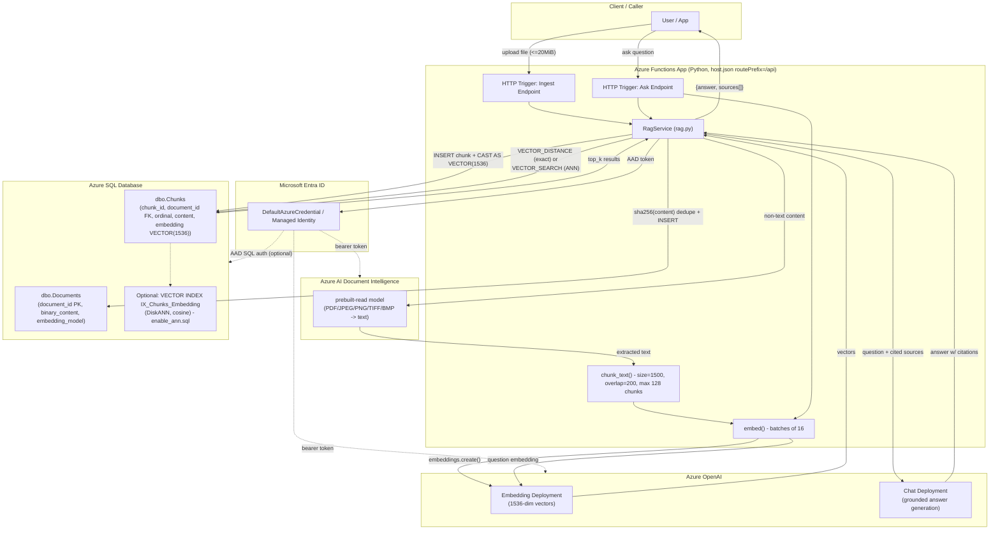

# RAGSolution — Architecture

Azure Functions (Python) based Retrieval-Augmented Generation (RAG) service. It ingests documents via Azure AI Document Intelligence, embeds chunks with Azure OpenAI, stores vectors natively in Azure SQL Database (`VECTOR(1536)`), and answers questions with citation-grounded Azure OpenAI chat completions.

## Architecture Diagram

## Workflow Sequences

### A. Ingestion Flow (`RagService.ingest`)
1. Validate `SQL_SEARCH_MODE != "ann"` (ingestion is disabled once the ANN index is enabled — read-only mode).
2. Validate payload: 1 byte – 20 MiB, filename <= 255 chars, content-type in allow-list.
3. If `text/plain`: decode UTF-8 directly. Else: call Document Intelligence `prebuilt-read` (120s timeout) to extract `result.content`.
4. `chunk_text()` — 1500 chars/chunk, 200 overlap, hard cap of 128 chunks (raises `InvalidInput` beyond that).
5. `embed()` — batches of 16 chunks sent to Azure OpenAI embeddings (1536 dims); validates response index alignment and finite/nonzero vector values.
6. `document_id = sha256(content)` — content-addressed dedupe key.
7. `SqlStore.save()` — transactional: `UPDLOCK, HOLDLOCK` read on `Documents` to detect existing doc; if same hash exists with a different embedding model -> reject; if identical -> no-op (idempotent); otherwise insert `Documents` row + per-chunk `Chunks` rows (embedding cast to `VECTOR(1536)`).

### B. Query / Ask Flow (`RagService.ask`)
1. Validate `question` (1–2000 chars) and `top_k` (int, 1–20).
2. Embed the question (same `embed()` path).
3. `SqlStore.search()` — mode-dependent SQL:
   - **exact**: `VECTOR_DISTANCE('cosine', ...)` full scan ordered by distance.
   - **ann**: `VECTOR_SEARCH(...TOP_N=20...)` against the DiskANN index, filtered to `top_k`.
   - Both filter by matching `embedding_model` to avoid cross-model comparisons.
4. Build numbered citation context from retrieved chunks.
5. Call Azure OpenAI chat completion with a system prompt enforcing: answer only from sources, cite `[n]`, treat source text as untrusted data (prompt-injection guard), temp=0, max_tokens=1000.
6. Return `{answer, sources: [{citation, document_id, filename, chunk, text, distance}]}`.

### C. Auth / Identity Flow
- `DefaultAzureCredential` is shared across OpenAI (bearer token provider for `cognitiveservices.azure.com`), Document Intelligence, and optionally SQL (via `SQL_USE_MANAGED_IDENTITY`, injecting the AAD token into the ODBC connection attrs, `SQL_COPT_SS_ACCESS_TOKEN = 1256`).
- `SqlStore.connection()` uses a context manager with commit/rollback semantics per operation.

### D. ANN Index Lifecycle
- `sql/schema.sql` provisions base tables transactionally (idempotent `IF OBJECT_ID IS NULL` guards).
- `sql/enable_ann.sql` enables preview features and creates a `DiskANN` vector index — but this makes `Chunks` read-only, which is why `ingest()` explicitly blocks writes when `SQL_SEARCH_MODE == "ann"`.
