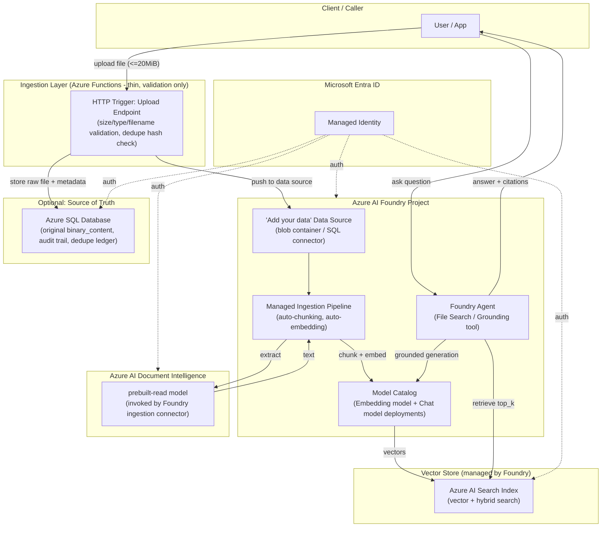

# RAGSolution — Future Architecture: Azure AI Foundry Variant

> **Status:** Proposal / not implemented. This document describes an alternative design using Azure AI Foundry's managed "Add your data" / Agent retrieval pattern, for comparison against the current custom implementation in `docs/ARCHITECTURE.md`.

## 1. Why Consider This
The current implementation (`rag.py`) hand-rolls chunking, embedding batching, vector storage in Azure SQL, retrieval SQL (exact/ANN), and a custom grounding prompt. Azure AI Foundry can provide managed equivalents for most of this, trading some fine-grained control for less custom code and built-in grounding/citation handling. This document captures what a Foundry-based redesign would look like, and explicitly calls out what changes, what is lost, and what is gained.

## 2. Proposed Architecture Diagram

## 3. Workflow Sequences

### A. Ingestion Flow (Foundry-managed)
1. Thin Azure Function (or direct upload) performs the same input validation as today: file size (<=20 MiB), filename length, content-type allow-list, and sha256-based dedupe check against a ledger (SQL or metadata store).
2. Validated file is written to a blob container (or kept in Azure SQL) registered as a Foundry **data source**.
3. Foundry's **"Add your data"** ingestion pipeline runs automatically (or on trigger): calls Document Intelligence for OCR/text extraction, chunks the text (chunk size/overlap configurable in Foundry settings), and generates embeddings via the configured embedding model deployment.
4. Embeddings + chunk text are written to an **Azure AI Search** index (hybrid vector + keyword fields), which Foundry manages and refreshes.
5. Original binary content and ingestion metadata (`document_id`, `embedding_model`, `created_at`) can still be persisted in Azure SQL for audit/compliance, decoupled from the vector index itself.

### B. Query / Ask Flow (Foundry Agent)
1. Client sends a question to a **Foundry Agent** (or Assistants-style endpoint) configured with a **File Search / Grounding tool** pointed at the Azure AI Search index.
2. The Agent automatically retrieves top-k relevant chunks from the index.
3. The Agent calls the chat model with retrieval results injected using Foundry's built-in grounding/citation format (equivalent to the current manual `[1]`, `[2]` citation prompt).
4. Response includes generated answer plus citation references back to source chunks/documents, as structured output.

### C. Auth / Identity Flow
- A single **Managed Identity** is used for the Foundry project, Document Intelligence, Azure AI Search, and (optionally) Azure SQL — same pattern as today via `DefaultAzureCredential`, but fewer custom token-exchange code paths since Foundry/Search integrate natively with Entra ID.

## 4. What Changes vs. Current Implementation

| Aspect | Current (`rag.py`) | Foundry Variant |
|---|---|---|
| Vector store | Azure SQL `VECTOR(1536)` column, custom `VECTOR_DISTANCE` / `VECTOR_SEARCH` SQL | Azure AI Search index (managed vector + hybrid search) |
| Chunking | Custom `chunk_text()` (1500/200, 128 cap) | Foundry-managed chunking (configurable, less granular control) |
| Embedding batching/validation | Custom batches of 16, index-alignment + finite/nonzero checks | Handled internally by Foundry's ingestion pipeline (less visibility) |
| Dedupe logic | sha256 content hash, embedding-model mismatch rejection, transactional `UPDLOCK/HOLDLOCK` | Must be reimplemented at the upload/validation layer; no built-in equivalent in Foundry |
| Citation/grounding prompt | Custom system prompt with explicit prompt-injection guarding | Foundry's built-in grounding format; prompt-injection guarding must be verified/configured, less direct control over wording |
| ANN read-only constraint | `sql/enable_ann.sql` makes `Chunks` read-only; `ingest()` blocks writes in ANN mode | **Removed** — Azure AI Search supports concurrent indexing and querying |
| Compute footprint | Full Azure Functions app owns ingestion + retrieval + generation orchestration | Thin Functions layer for validation only; Foundry owns orchestration |
| Operational surface | Single data store (Azure SQL) to monitor/back up | Two stores to reconcile (Azure SQL for raw content/audit, Azure AI Search for vectors) + Foundry project governance |
| Cost model | Azure SQL compute + OpenAI + Document Intelligence | Adds Azure AI Search pricing tier + Foundry project/hub costs |

## 5. What Is Gained
- No more ANN-mode ingestion lockout — indexing and querying can happen concurrently.
- Less custom orchestration code to maintain (chunking, embedding batching, SQL retrieval queries).
- Built-in citation/grounding format maintained by Microsoft, reducing custom prompt-engineering surface.
- Easier to extend with multi-modal or agentic tool use (Foundry Agents support adding more tools beyond File Search).

## 6. What Is Lost / Needs Reimplementation
- Fine-grained content-hash dedupe and embedding-model mismatch protection (must be rebuilt at the ingestion-trigger layer).
- Exact control over chunk size/overlap/cap enforcement and transactional guarantees across `Documents`/`Chunks`-equivalent tables.
- Single-store simplicity — introduces Azure AI Search as a second system of record for vectors, requiring reconciliation with Azure SQL (or dropping SQL storage of binary content entirely, which has its own audit/compliance implications).
- Exact wording/control of the prompt-injection-resistant system prompt; must validate Foundry's default grounding instructions meet the same security bar.

## 7. Recommendation
Treat this as an **option to evaluate**, not a required migration. If ingestion-time read-availability (removing the ANN read-only gate) or reduced custom-code maintenance is a priority, prototype the Foundry + Azure AI Search path with a side-by-side index built from a subset of existing documents, and compare retrieval quality, latency, and citation accuracy against the current Azure SQL-based implementation before committing to migration.
